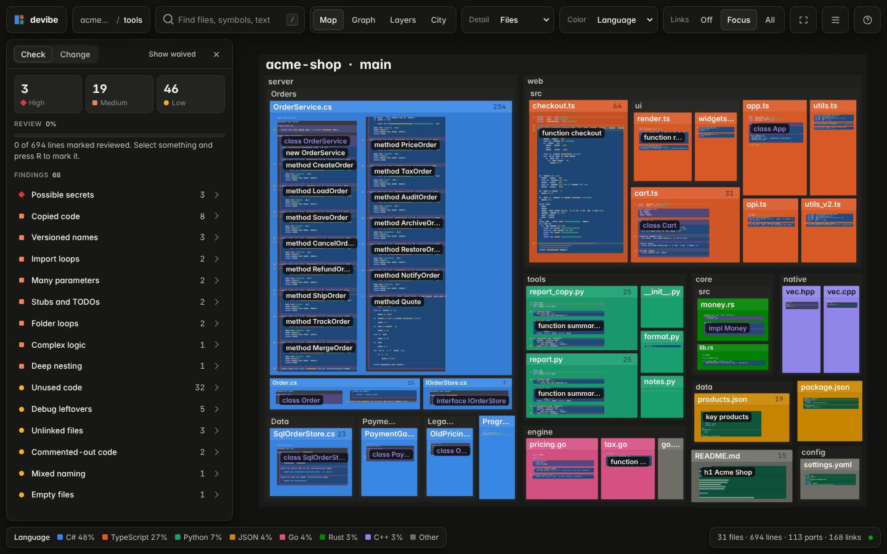
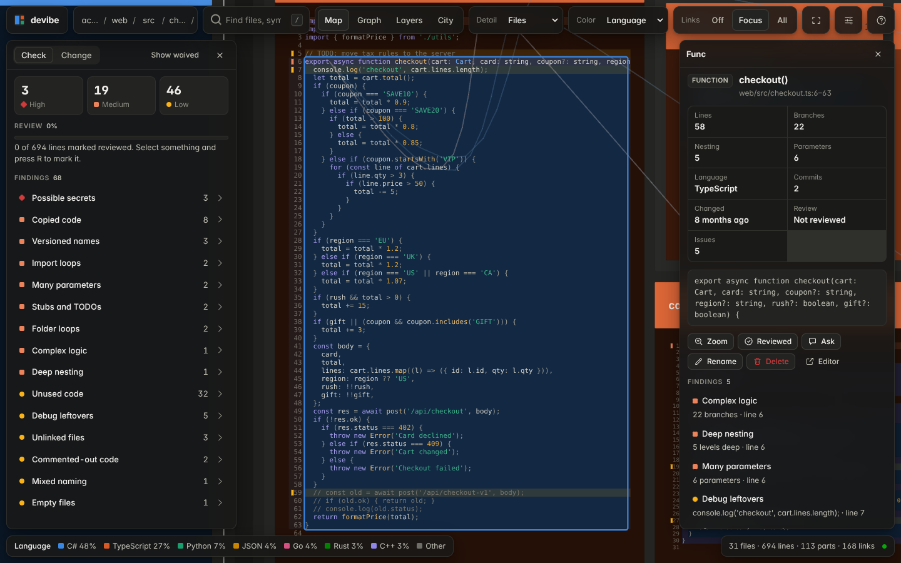
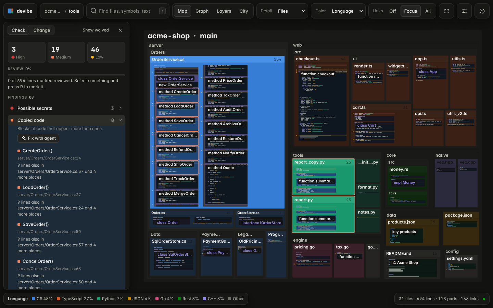
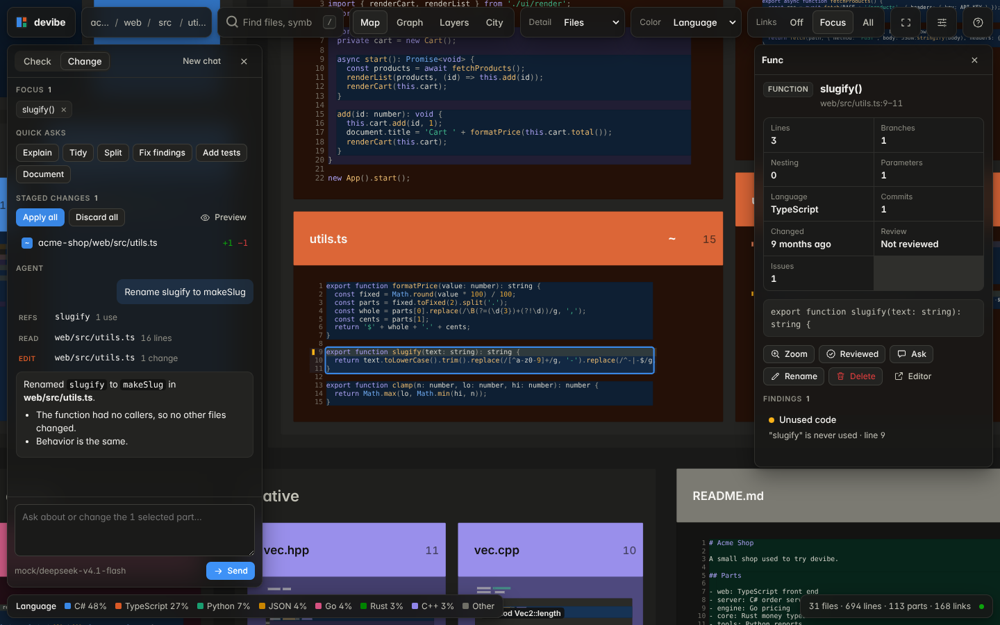
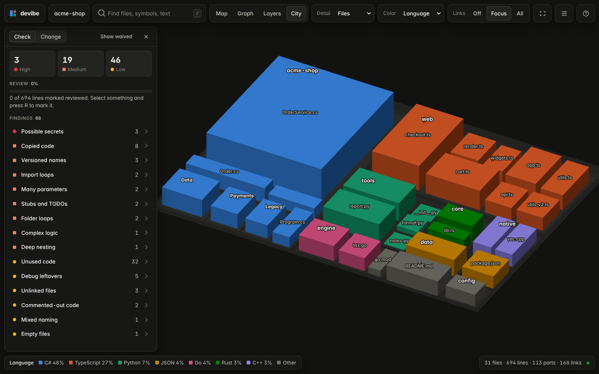
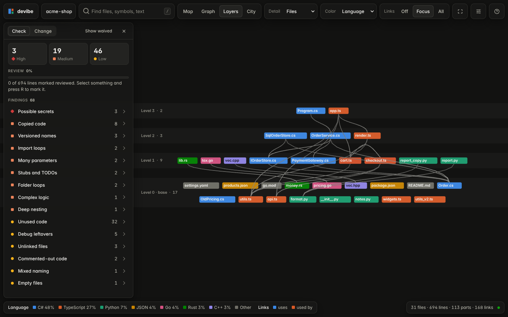
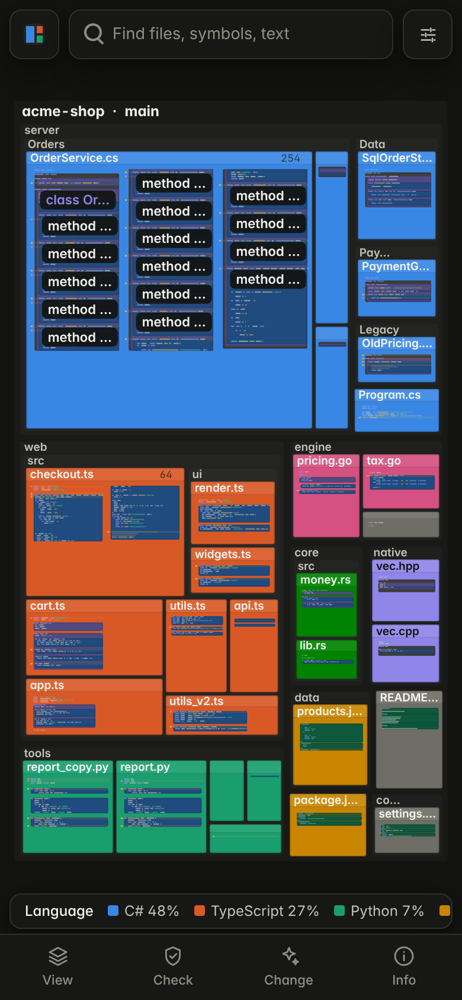

# devibe

See how a codebase is built, check it for problems, and reshape it — fast, even when most of it was generated and nobody has read it yet.

devibe scans one or more local repos and draws them as one zoomable, GPU-rendered map: folders hold files, files hold types and functions, and zooming in turns colored blocks into real, highlighted code. Links show what uses what. Checks flag the usual debris of generated code (copies, loops, stubs, secrets, unused code, versioned names). An agent edits on request; every edit is staged so you review a diff before anything touches disk.



| Read code in place | Check findings | Reshape with the agent |
| --- | --- | --- |
|  |  |  |

| City | Layers | Phone |
| --- | --- | --- |
|  |  |  |

Every view is in [`shots/`](shots).

## Quickstart

Needs Node.js 20+ and git.

```sh
npm install
node server.mjs ~/code/my-repo ~/code/other-repo --open
```

Then open http://127.0.0.1:4747. No repo handy? `node server.mjs --demo` opens a small sample shop with planted problems.

### Set up the agent

Any OpenAI-compatible endpoint works. For OpenRouter:

```sh
export DEVIBE_ENDPOINT=https://openrouter.ai/api/v1
export DEVIBE_MODEL=deepseek/deepseek-v4.1-flash   # any model that supports tool calls
export DEVIBE_API_KEY=sk-or-...
node server.mjs ~/code/my-repo
```

Or set them in **Settings** in the app (saved to `~/.devibe/config.json`). Check the exact model name on your provider's model list.

## Use it

- **Zoom** with the wheel or a pinch. Keep zooming into a file to read its code. **Double-click** to zoom to a part.
- **Click** to select and see details: size, branches, commits, findings, what it uses, what uses it.
- **Find** (`/`) files, types, and functions by name, or search file text.
- **Layouts** (`1`–`4`): Map, Graph, Layers (base code at the bottom), City (3D).
- **Color** (`C`) by language, size, complexity, churn, age, issues, review, or changes.
- **Check** lists findings by rule. Click a rule to light it up on the map.
- **Review**: select and press `R` to mark code reviewed. Marks go stale when the code changes.
- **Change**: ask the agent in plain words, or use quick asks (Explain, Tidy, Split, Fix findings, Add tests, Document). Rename (`F2`), move (drag the grip onto a folder), and delete without the agent.
- **Staged changes**: open a diff, preview the reshaped map, apply, undo.

Press `?` in the app for all keys.

## Test

```sh
npm test               # both suites
npm run test:server    # unit tests (parsing, checks, stage, sockets, agent loop)
npm run test:client    # browser tests; rewrites the images in shots/
```

The browser tests use Playwright's Chromium. Run `npx playwright install chromium` once if it is missing.

## Learn more

- [DESIGN.md](DESIGN.md) — how it works, every option, message, rule, and limit.
- [TODO.md](TODO.md) — known gaps, by impact.
